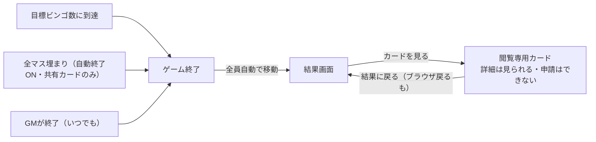

# ミッションビンゴ 仕様まとめ（壁打ち v1）

Oct 12, 2026 · @カンタ

## 概要

マスに書かれたミッションをこなしてカードを開けていき、相手より先に指定数のビンゴを達成したプレイヤー（チーム）が勝つオンライン対戦ビンゴ。数字の抽選ではなく、ミッション達成でマスが開くのが特徴。

- 勝利条件：指定数のビンゴを最初に達成
- 参加単位：個人またはチーム（個人参加も「1人のチーム」として扱う）
- 想定プレイヤー層：身内向け

## ゲーム設定

ルーム作成時に「GMの有無」と「カード形式」を組み合わせて選ぶ。

| 設定 | 選択肢 | 内容 |
| --- | --- | --- |
| GM | あり | プレイヤーが申請し、GMが確認・承認するとマスを取得 |
| GM | なし | 申請した時点で即取得。進行判断は操作主（ルーム作成者）が行う。操作主はチームに所属してプレイし、加えてGM相当の操作メニューを開ける |
| カード形式 | 個別カード | 各プレイヤー（チーム）が自分のカードを持つ |
| カード形式 | 共有カード | 全チームで1枚のカードを奪い合う（アタック25型） |

申請方法はチャットがデフォルトで、お題ごとに「画像必須」をオン/オフできる。

## 参加

ルームコードを入力し、表示名を入れてチームを選んで参加する。参加後のチーム移動はできない。

ゲームはルーム作成（GM / 操作主が開始）の時点で始まっており、プレイヤーはゲーム中いつでもルームに合流して参加できる。

- GM：どのチームにも所属しない
- 操作主（GMなしのとき）：チームに所属する（移動不可）
- 表示名：参加時に入力する。タイムラインの「誰が」に使う

## 申請と承認

GMありのときは、申請が早い順にGMが確認し、許可が出た時点でそのマスは締め切りになる。

- 申請方法：チャット申請（デフォルト）と画像申請。画像必須かどうかはお題ごとに設定する
- チャット申請：コメントの入力を必須とする
- 申請が重なった場合：申請時刻順に確認し、最初に許可された申請でマスが確定する。同じマスへの他の申請は却下扱いになる
- 却下時：GMがコメントを付けて返す。却下されたチームは同じマスに再申請できる
- 同じチームが同じマスに重ねて申請することはできない（申請中は1件まで）
- 共有カードでは、他のチームが取得済みのマスには申請できない（奪えるのは特別ミッションのみ）
- FREE マスは全チーム共通の取得済みマスとして扱う
- 承認画面：できるだけ簡略化する（許可/却下と、却下時のコメント入力のみ）
- GMなしの場合：申請と同時に取得。画像はタイムラインに証拠として残る

## タイムライン

ゲーム中の出来事を時系列で全員が見られるタイムラインを付ける。

- 申請タイミング（誰が、どのマスを、チャットまたは画像で）
- 許可タイミング
- 却下（コメント付き）
- 特別ミッションの発生と、奪取の結果

## 奪取ルールと特別ミッション

共有カードでは、特別ミッションで一番の成績を出したチームが好きなマスを1つ奪える。

- 発生：GMありならGMが任意のタイミングで発生させる。GMなしなら操作主が発生させる
- 判定：GMありならGM、GMなしなら操作主が行う

| タイプ | 例 | 判定方法 |
| --- | --- | --- |
| 速さ | 一番早く〇〇 | 最初に許可された申請が勝ち |
| 量 | 一番多く〇〇 | 制限時間内の数を比較 |
| 質 | 一番綺麗な〇〇 | 画像必須。GMなしのときは「操作主が決める」か「全員投票」をルーム設定で選ぶ |

- 制限時間：特別ミッションごとに設定する
- 同時に動かせる数：最大3つ（各タイプ1つずつ）。その間も通常のマスの申請・承認は続く
- 提出：コメント必須のチャットで提出する。質タイプは画像必須（画像申請の実装後）、量タイプのみ画像を複数枚提出できる
- 速さ：通常のマスと同じ処理。GMありなら最初に許可された提出、GMなしなら最初の提出のチームが勝ち
- 量：制限時間内に何件でも提出できる。時間切れの後、GM（GMなしなら操作主）が各チームの数を入力し、最も多いチームが勝ち
- 質：時間切れの後、GM / 操作主が1位を決める。GMなしで「全員投票」のときは時間切れの後に投票を受け付ける
- 奪取の対象：他チームが持っているマスから1つ。空きマスは奪えない。ビンゴが成立したラインのマスも奪える
- 全員投票：1人1票。自チームへの投票は禁止
- 同票：1位のチームすべてが、マスを1つずつ奪える
- 質タイプの判定方法（GMなし・共有カードのみ）：ルーム作成時に「操作主が決める / 全員投票」から選ぶ。デフォルトは「操作主が決める」

## 画像の保存

画像はゲーム終了後3日間保存し、その間に結果用の画像を出力できるようにする。保存先はCloudflare R2（ライフサイクルルールで自動削除）。

## ルーム作成

ルーム作成時にカードの大きさ・FREE・チーム数を選び、マス数より多いタスク候補から抽選してカードを作る。

| 設定 | 選択肢 | デフォルト | 内容 |
| --- | --- | --- | --- |
| カードサイズ | 5×5 / 7×7 / 9×9 | 5×5 | 奇数のみ。FREEありのとき中央がFREE |
| FREE | あり / なし | あり | ありのとき必要タスク数は「マス数−1」 |
| チーム数 | 2〜6 | 3 | チームごとに見分けやすい色を割り当てる |
| 目標ビンゴ数 | 1〜カードのライン数（5×5：12 / 7×7：16 / 9×9：20） | 2 | このビンゴ数に最初に到達したチームが勝つ |
| タスク候補 | 必要数以上 | — | 候補の中から必要数を抽選して配置 |
| 自動終了（共有カードのみ） | する / しない | しない | 目標ビンゴ数に届かず全マスが埋まったときに自動終了するか |

抽選はルームで1回だけ行い、個別カードでも全チームが同じ並びのカードを使う（公平性のため）。抽選結果はルームに保存し、再接続時も同じカードを再現する。

入力画面では「あと◯個必要」を常に表示し、必要数に届くまで作成できない。タスクはCSV / JSONで一括入力・出力でき、項目は次の3つ。

| 項目 | 必須 | 内容 |
| --- | --- | --- |
| title | 必須 | マスに表示する短いタイトル（全角6〜8文字程度が目安。10文字を超えると警告、25文字が上限） |
| detail | 任意（null可） | タップ時に表示する詳細 |
| imageRequired | 任意（省略時 false） | 画像必須のお題かどうか |

## GM操作

GMはプレイ中にマスの取り消しとゲーム終了ができ、個別カードでは全チームのカードを見られる。GMなしのときは操作主が同じ操作（取り消し・終了・全チームのカード閲覧）を行える。操作主は自チームかどうかに関係なく、すべてのチームのマスを取り消せる。

| 操作 | 内容 |
| --- | --- |
| マス取り消し | 取得済みのマスを未取得に戻す。取り消し理由の入力は必須 |
| ゲーム終了 | いつでも終了でき、全員が結果画面へ移動する |
| 全チームのカード閲覧 | 個別カードのとき、タブまたはサムネイル一覧で各チームのカードを切り替えて見る |

個別カードでは、GM・操作主以外のプレイヤーも他チームの進捗を簡易カード（取得マスの色分けとライン数・マス数のみ）で見られる。マスの詳細までは見せない。

取り消しはビンゴの成立に関係なく実行し、取り消し後の状態で順位を決める。順位はビンゴ数が多い順で、同数なら取得マス数が多い順、それも同じなら同率とする。取り消されたマスには再挑戦できる。取り消しの記録（マス・チーム・理由・時刻）はタイムラインに残す。

## プレイ画面

マスには短いタイトルだけを表示し、タップすると詳細シートが開く。9×9ではスマホの1マスがかなり小さくなるため、タイトルの短さが前提になる。

詳細シートには、タイトル・詳細・状態（未達成 / 申請中 / 達成済み）・達成申請ボタンをまとめる。詳細がnullのマスはタイトルと状態だけを表示する。

## ゲーム終了と画面遷移

終了のきっかけに関係なく全員が自動で結果画面へ移動し、そこから開くカードは閲覧専用になる。

結果画面には、順位（ビンゴ数・取得マス数）、終了のきっかけ、タイムラインを表示する。あわせて、各チームが提出した画像からランダムで1枚ずつを載せる。

終了後は、個別カードでも全員が全チームのカードを見られる。

閲覧専用カードでは詳細シートは開けるが達成申請ボタンは出さず、画面上部に「ゲーム終了・閲覧モード」のバナー、下部に「結果に戻る」ボタンを固定表示する。ブラウザの戻る操作でも結果画面に戻る。UIだけでなくサーバー側でも、終了済みルームへの申請・取り消しは受け付けない。

## 想定シーンと類似サービス

想定シーンは、街中の物探しとゲームのミッション達成。

| 類似サービス | 近い点 | 違い |
| --- | --- | --- |
| [Bingosync](https://bingosync.com/about) | 共有カードで、マスの奪い合い（Lockout / Flip Lockout）ができる | 承認フローがなく、スピードラン向け |
| [Goosechase](https://blog.goosechase.com/best-practices-for-showing-missions-in-the-activity-feed/) | ミッション達成と主催者の審査がある | ビンゴではなくポイント制 |

「ミッション×ビンゴ×GM承認×奪取」の組み合わせが差別化ポイントになる。

## 未決事項

- [x] 画像の保存先サービスの選定 → Cloudflare R2
- [ ] 画像のサイズ上限と圧縮の方針
- [ ] 結果用画像に何を載せるか
- [x] ビンゴ数が同じときの順位の決め方 → 取得マス数が多い順、それも同じなら同率
- [x] GMなしのとき、マスの取り消しを操作主ができるか → できる（全チームのマスが対象）
- [x] 個別カードで、終了後に全員が他チームのカードを見られるか（GMのみに限るか） → 全員が見られる
- [x] チーム数の最小値 → 2
